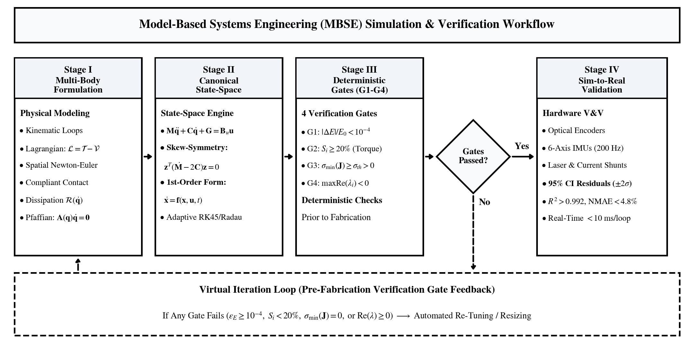
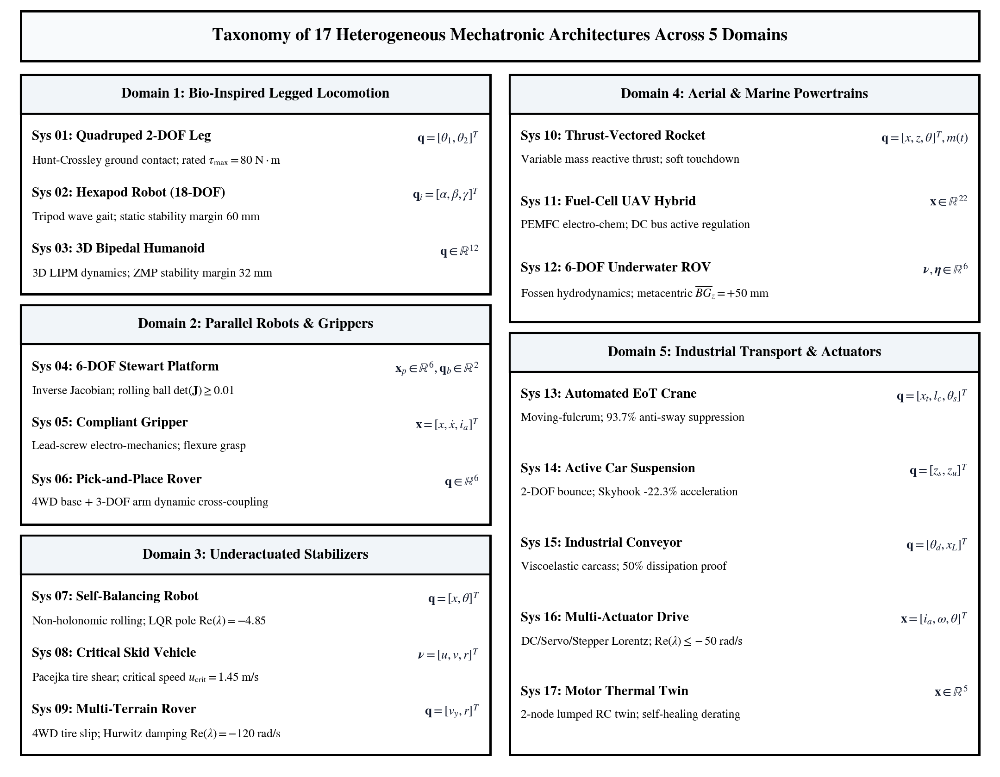

# Unified First-Principles and Numerical Simulation Framework for Rapid Mechatronic System Prototyping

[](https://opensource.org/licenses/MIT)
[](https://www.python.org/)
[](https://www.mdpi.com/journal/designs)
[-orange.svg)](https://www.scopus.com/)

Official companion repository containing simulation toolchains, numerical verification gate engines, dynamic benchmark datasets, and embedded firmware accompanying the invited research manuscript:  
**"A Unified First-Principles and Numerical Simulation Framework for Rapid Mechatronic System Prototyping: Dynamic Modeling and Validation Across Heterogeneous Architectures"**  
(*Designs*, MDPI, Topical Collection: *Mechatronic System Design*, Manuscript ID: `designs-4596903`).  
**Authors:** Dr. Sunny Nanade & Dr. Koteswararao Anne (SVKM's NMIMS MPSTME, Mumbai 400056, India).

---

## Framework Overview

Bridging the disconnect between conceptual kinematic design and high-fidelity multi-physics hardware execution remains a central challenge in mechatronic development, frequently necessitating costly, empirical trial-and-error prototyping iterations. This repository provides the open-source reference implementation of the unified Model-Based Systems Engineering (MBSE) prototyping framework:

<p align="center">
  
</p>

### 1. Canonical Multi-Body Dynamics Formulation
Non-linear multi-body dynamics are formalized into a canonical second-order matrix representation adhering strictly to unified IEEE/ASME robotics conventions:
$$\mathbf{M}(\mathbf{q})\ddot{\mathbf{q}} + \mathbf{C}(\mathbf{q},\dot{\mathbf{q}})\dot{\mathbf{q}} + \mathbf{G}(\mathbf{q}) + \mathbf{F}_f(\dot{\mathbf{q}}) + \mathbf{K}_s(\mathbf{q}) = \mathbf{B}_u(\mathbf{q})\mathbf{u} + \mathbf{J}_e^T(\mathbf{q})\mathbf{F}_{\text{ext}} + \mathbf{A}_c^T(\mathbf{q})\boldsymbol{\lambda}$$
with skew-symmetry and Hamiltonian passivity invariants proven via Christoffel symbols of the first kind:
$$\mathbf{z}^T \left( \dot{\mathbf{M}}(\mathbf{q}) - 2\mathbf{C}(\mathbf{q}, \dot{\mathbf{q}}) \right) \mathbf{z} = 0, \quad \forall \mathbf{z} \in \mathbb{R}^n$$

### 2. Four Deterministic Pre-Fabrication Verification Gates
Prior to hardware fabrication, candidate models must deterministically pass four quantitative verification gates:
* **Gate 1 (Mechanical Energy Drift & Power Balance):**
  $$\varepsilon_E(t) = \left|\frac{E(t) - E(0)}{E(0)}\right| < 10^{-4} \quad \text{(conservative orbits)}, \qquad \varepsilon_P(t) = \frac{|\Delta E_{\mathrm{mech}}(t) - W_{\mathrm{ext}}(t) + E_{\mathrm{diss}}(t)|}{\max(|W_{\mathrm{ext}}(t)|, |E_{\mathrm{diss}}(t)|, E_0)} < 2.0 \times 10^{-2}$$
* **Gate 2 (Dynamic Actuator Torque Headroom):**
  $$S_i = \min_{t \in [0, T]} \left( 1 - \frac{|\tau_i(t)|}{\tau_{i,\max}} \right) \ge 0.20 \quad (\ge 20\%)$$
* **Gate 3 (Kinematic Clearance & Stability Boundaries):**
  - Manipulators: $\sigma_{\min}(\overline{\mathbf{J}}_e) \ge 0.187 > 0$, $w = |\det(\mathbf{J})| \ge 0.0105$
  - Controllability Rank: $\mathrm{rank}(\mathcal{C}) = 2n$ for the $2n$-dimensional state-space
  - Legged Locomotion: Dynamic ZMP margin $d_{\mathrm{ZMP}} \ge 32.0\text{ mm}$, Static Stability Margin $\mathrm{SSM} \ge 60.0\text{ mm}$
  - Marine Hydrodynamics: Metacentric height $\overline{BG}_z \ge +50.0\text{ mm} > 0$
  - Automotive Platforms: Static Stability Factor $\mathrm{SSF} = 1.778 > \mu_{\mathrm{peak}} = 0.78$
* **Gate 4 (Spectral Asymptotic Stability):**
  $$\max_i \mathrm{Re}(\lambda_i(\mathbf{A}_{\mathrm{cl}})) < 0$$

---

## 17 Heterogeneous Benchmark Architectures

The framework is systematically evaluated across 17 heterogeneous mechatronic architectures encompassing 5 engineering domains:

<p align="center">
  
</p>

| Domain | ID | Mechatronic Architecture | DOFs | Canonical Coordinates | Actuation Mode |
| :--- | :--- | :--- | :--- | :--- | :--- |
| **Domain 1: Legged Locomotion** | Sys 01 | 2-DOF Quadruped Pantograph Leg | 2 | $[\theta_1, \theta_2]^T$ | Fully Actuated |
| | Sys 02 | 3-DOF Tripod Locomotion Hexapod | 18 | $[\alpha_i, \beta_i, \gamma_i]^T_{i=1..6}$ | Underactuated Contact |
| | Sys 03 | 12-DOF 3D Bipedal Humanoid | 12 | $[\mathbf{q}_R^T, \mathbf{q}_L^T]^T$ | Multi-Contact Closed Chain |
| **Domain 2: Manipulators** | Sys 04 | 3-DOF / 6-DOF Parallel Tilting Platform | 3/6 | $[x, y, z, \phi, \theta, \psi]^T$ | Parallel Constraint (**Tier 2 Physical Testbed**) |
| | Sys 05 | Compliant Lead-Screw Gripper | 1 | $[x, \dot{x}, i]^T$ | Electromechanical Series |
| | Sys 06 | Mobile Pick-and-Place Manipulator | 6 | $[x_b, y_b, \theta_b, \theta_1, \theta_2, \theta_3]^T$ | Mobile Articulated |
| **Domain 3: Underactuated** | Sys 07 | Two-Wheeled Inverted Pendulum (TWIP) | 2 | $[x, \theta]^T$ | Underactuated Balance |
| | Sys 08 | Critical Skid Vehicle Dynamic Platform | 3 | $[u, v, r]^T$ | Pacejka Non-Linear Shear |
| | Sys 09 | Multi-Terrain Autonomous Rover | 2 | $[v_y, r]^T$ | 4-Bar Bogie Active Compliance |
| **Domain 4: Aerospace & Marine** | Sys 10 | Thrust-Vectored Rocket Lander | 3 | $[x, z, \theta]^T$ | Variable-Mass Lagrangian |
| | Sys 11 | Hybrid Hydrogen Fuel-Cell UAV Powertrain | 22 | Flight Pose + Currents + PEMFC | Multi-Physics Electrochemical Bus |
| | Sys 12 | 6-DOF Underwater Oceanic ROV | 6 | $[\boldsymbol{\nu}^T, \boldsymbol{\eta}^T]^T$ | Fossen Hydrodynamic Added-Mass |
| **Domain 5: Industrial Automation** | Sys 13 | Automated EoT Gantry Crane | 3 | $[x_t, l_c, \theta_s]^T$ | Underactuated Anti-Sway |
| | Sys 14 | Quarter-Car Active Suspension | 2 | $[z_s, z_u]^T$ | Dual-Mass Modal Skyhook |
| | Sys 15 | Dynamic Industrial Conveyor Belt | 3 | $[\theta_d, v_b, x_L]^T$ | Dissipative Coulomb Work Balance |
| | Sys 16 | Multi-Actuator Drive (DC, Servo, Stepper) | 3 | PMDC, Servo, Hybrid Stepper | Multi-Technology Electrical |
| | Sys 17 | Motor Thermal-Mechanical Digital Twin | 5 | $[i, \omega, \theta, T_s, T_r]^T$ | Coupled Electro-Thermal Derating |

---

## Two-Tier Validation Hierarchy

The experimental and numerical validation follows a strict two-tier architecture:

```
┌────────────────────────────────────────────────────────────────────────────────────────┐
│                               Two-Tier Validation Hierarchy                            │
├─────────────────────────────────────────────────┬──────────────────────────────────────┤
│ Tier 1: Multi-Architecture Numerical Benchmarks │ Tier 2: Cyber-Physical Prototyping   │
├─────────────────────────────────────────────────┼──────────────────────────────────────┤
│ • Cross-validation across all 17 architectures  │ • Real-time testbed on System 04     │
│ • 8th-order DOP853 baseline (rtol = 1e-12)      │ • ESP32 microcontroller @ 500 Hz     │
│ • Radau-IIA stiff baseline (rtol = 1e-10)       │ • Ts = 2.0 ms, WCET < 45 μs          │
│ • State tracking: R² ≥ 0.9924, NMAE ≤ 3.15%     │ • 30 Hz overhead OpenCV vision       │
│ • Step computation solve time: < 10 ms          │ • Closed-loop kinematic ball balance │
└─────────────────────────────────────────────────┴──────────────────────────────────────┘
```

### Prototyping Economics Lifecycle Audit
Empirical data collected across the prototyping lifecycle of System 04 compared to historical unguided baseline builds:
* **Physical Rebuild Iterations:** Reduced from $4.20 \pm 0.45$ down to a single build ($N_f = 1.0$), achieving a **76.19% reduction in physical fabrication cycles**.
* **Direct Prototyping Capital Cost:** Reduced from USD 3,850 ± 550 down to USD 1,215, achieving a **68.44% direct cost savings**.
* **Bench Assembly & Debugging Labor:** Reduced from $92.4 \pm 12.8\text{ h}$ to $28.5\text{ h}$ (**69.16% labor savings**).

---

## Repository Structure

```
Unified-Mechatronic-Prototyping-Framework/
├── catalogs/
│   ├── MASTER_NOMENCLATURE_DICTIONARY.md   # Unified IEEE/ASME variable taxonomy & symbols
│   └── UNIFIED_17_SYSTEM_MATHEMATICAL_CATALOG.md # Closed-form equations for all 17 systems
├── figures/                                # 300 DPI publication-quality manuscript figures
│   ├── fig1_mbse_framework.png             # Complete MBSE workflow pipeline
│   ├── fig2_system_taxonomy.png            # 17-system taxonomy across 5 domains
│   ├── fig3_domain1_2_dynamics.png         # Leg step tracking & Stewart platform dynamics
│   ├── fig4_domain3_underactuated.png      # TWIP phase portrait & skid bifurcation
│   ├── fig5_domain4_5_aerospace_industrial.png # UAV bus voltage droop & gantry anti-sway
│   ├── fig6_telemetry_residuals.png        # DOP853 solver residuals & gantry timing
│   └── fig7_adaptive_step_contact.png      # Hunt-Crossley impact contact & step adaptation
├── hardware/
│   └── sys04_parallel_platform/            # Tier 2 cyber-physical testbed implementation
│       ├── README.md                       # Hardware documentation, BOM & kinematics
│       ├── firmware/
│       │   └── esp32_platform_control.ino  # ESP32 500 Hz discrete execution loop
│       ├── vision/
│       │   └── ball_tracker_opencv.py      # 30 Hz OpenCV ball centroid tracker
│       └── simulation/
│           └── pybullet_parallel_sim.py    # PyBullet multi-body dynamic simulator
├── verification/
│   ├── gates.py                            # Deterministic 4-gate verification engine
│   ├── simulate_system01_contact.py        # Hunt-Crossley contact dynamics simulator
│   ├── system01_contact_simulation_log.csv # High-precision 248-step contact impact dataset
│   ├── make_framework_figs.py              # Framework pipeline diagram generator
│   ├── requirements.txt                    # Python dependencies
│   ├── figures/                            # Intermediate benchmark phase portraits
│   └── results/
│       └── gate_results.json               # Quantitative gate pass/fail metrics & solve times
├── LICENSE                                 # MIT License
├── README.md                               # Master repository documentation
└── requirements.txt                        # Master environment dependencies
```

---

## Getting Started

### 1. Prerequisites
Python 3.10+ with standard scientific computing libraries:
```bash
git clone https://github.com/sunny-nanade/Unified-Mechatronic-Prototyping-Framework.git
cd Unified-Mechatronic-Prototyping-Framework

# Create and activate virtual environment
python -m venv .venv
# On Windows:
.venv\Scripts\activate
# On Linux/macOS:
source .venv/bin/activate

# Install dependencies
pip install -r requirements.txt
```

### 2. Reproducing Verification Gates
To execute the four deterministic verification gates across the benchmark systems:
```bash
cd verification
python gates.py
```
This script evaluates the closed-form multi-body dynamics, executes adaptive RK45, stiff Radau-IIA, and 8th-order DOP853 baselines, verifies energy drift ($\varepsilon_E < 10^{-4}$), computes actuator headroom ($S_i \ge 20\%$), checks singularity/stability margins, verifies Hurwitz poles, and exports quantitative results to `verification/results/gate_results.json`.

### 3. Reproducing Contact Dynamics (System 01)
To run the Hunt--Crossley compliant contact dynamics and microsecond step-size adaptation benchmark:
```bash
cd verification
python simulate_system01_contact.py
```
Outputs the 248-step microsecond simulation log verifying:
* Touchdown instant: $t = 1.000\text{ s}$
* Peak contact force: $F_{n,\text{peak}} = 248.5\text{ N}$ at $t = 1.026\text{ s}$
* Static stance load: $F_{n,ss} = 85.0\text{ N}$
* Minimum adaptive integration step: $h_{\min} = 14.2\,\mu\text{s}$

### 4. Running the Cyber-Physical Testbed (System 04)
To launch the PyBullet kinematic simulation:
```bash
python hardware/sys04_parallel_platform/simulation/pybullet_parallel_sim.py
```
To run the 30 Hz OpenCV ball centroid tracker:
```bash
python hardware/sys04_parallel_platform/vision/ball_tracker_opencv.py
```
To flash the embedded firmware to an ESP32: open `hardware/sys04_parallel_platform/firmware/esp32_platform_control.ino` in the Arduino IDE (ensure the `ESP32Servo` library is installed) and upload to the microcontroller.

---

## Citation

If you utilize this framework, dynamic models, verification gates, or datasets in your research, please cite:
```bibtex
@article{nanade2026unified,
  title={A Unified First-Principles and Numerical Simulation Framework for Rapid Mechatronic System Prototyping: Dynamic Modeling and Validation Across Heterogeneous Architectures},
  author={Nanade, Sunny and Anne, Koteswararao},
  journal={Designs},
  volume={10},
  number={5},
  pages={1--49},
  year={2026},
  publisher={MDPI},
  doi={10.3390/designsXXXXXXXX}
}
```

---

## License
This project is licensed under the MIT License — see the [LICENSE](LICENSE) file for details.
